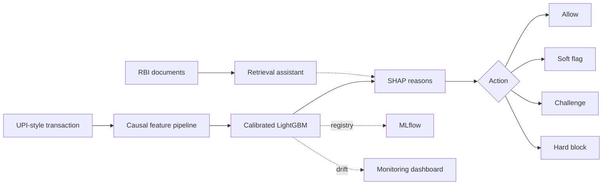

 

---

Final-year Computer Science and Engineering student at **SNS College of Technology, Coimbatore**, and Machine Learning Intern at **Epoch Minds**. I take an idea from problem discovery to a working API and a usable interface, usually under a hackathon clock.

---

## The Hackathon Trail

| Hackathon | What I built | Result |
|---|---|---|
| **EVOX 1.0** (DETOX, on Unstop) | [City of One Rule](https://github.com/Sri-Gowtham/city-of-one-rule), a browser city simulation you steer with one rule a day, built with teammate Sanjana BR | **Winner, 1st place** among 2,000+ participants |
| **Odoo × SNS Hackathon 2026** | E-Learning Platform, built as a team ([repository](https://github.com/Sri-Gowtham/globe_trotter)) | **2nd Runner-Up** |
| **WebRush 2026** | [Rewind](https://github.com/Sri-Gowtham/rewind), listening data turned into story chapters | **48th place** among 1,000+ participants |

---

## Featured Work

### [PayWatch](https://github.com/Sri-Gowtham/paywatch): my major ML project

Fraud scoring for UPI-style transactions, built end to end: a causal feature pipeline, a calibrated LightGBM scorer, SHAP reasons in plain language, a serving API, drift monitoring, a dashboard and an assistant that answers from RBI documents. It scores a transaction in about 2 ms and returns one of four actions: allow, soft flag, challenge or hard block.

| PR-AUC | ROC-AUC | Fraud caught at 1% false positives | Hard-block precision | Automated tests |
|:---:|:---:|:---:|:---:|:---:|
| **0.724** | **0.956** | **65%** | **92%** | **84** |

Measured on the latest 15% of time (88,581 transactions, 3.5% fraud) of the public IEEE-CIS Fraud Detection data, using time-ordered splits with no look-ahead. A random scorer gets 0.035 PR-AUC and a model without entity history gets 0.581. The data is a Western e-commerce dataset, not UPI traffic; the repo lists this and the other limitations in full.

<table>
<tr>
<td width="50%"></td>
<td width="50%"></td>
</tr>
<tr>
<td align="center">Live scoring with a risk gauge and plain-language reasons</td>
<td align="center">Drift monitoring</td>
</tr>
</table>

### More featured projects

<table>
<tr>
<td width="50%" valign="top">

#### [City of One Rule](https://github.com/Sri-Gowtham/city-of-one-rule)
**EVOX 1.0 winner.** You are the temporary mayor. Set one rule per day from a deck of 40 and watch 72 citizens react, copy each other and reshape the city. Drawn procedurally on a canvas, with a deterministic simulation. [Play it](https://sri-gowtham.github.io/city-of-one-rule/).

</td>
<td width="50%" valign="top">

#### [CatalogIQ](https://github.com/Sri-Gowtham/catalogiq)
**In development.** 11 agents that enrich, validate and publish FMCG product listings, with a feedback loop for optimisation. Built for the SNS Square Agent Workbench (UC-49).

</td>
</tr>
<tr>
<td width="50%" valign="top">

#### [FinSight Analytics Intelligence](https://github.com/Sri-Gowtham/finsight-analytics-intelligence)
AI financial intelligence for Indian banking: explainable insights, peer comparison and scenario analysis for consultancy firms.

</td>
<td width="50%" valign="top">

#### [OptiForge AI](https://github.com/Sri-Gowtham/OptiforgeAI)
Describe a mechanical part or a floor plan in plain language and get an editable 2D CAD drawing. A constraint-driven geometry engine runs in the browser, with design-for-manufacturing warnings and SVG and DXF export.

</td>
</tr>
<tr>
<td colspan="2" valign="top">

#### [Employee Attrition AI](https://github.com/Sri-Gowtham/Employee-Attrition-AI)
HR analytics platform that predicts who is likely to leave and why. A Random Forest pipeline with SHAP explanations, interactive workforce dashboards, batch scoring, and prescriptive retention recommendations for at-risk employees.

</td>
</tr>
</table>

---

## Also Worth a Look

<table>
<tr>
<td width="50%" valign="top">

#### [BudgetBee AI Finance](https://github.com/Sri-Gowtham/budget-bee-ai-finance)
AI-assisted personal finance and budgeting app.

</td>
<td width="50%" valign="top">

#### [MatchLens](https://github.com/Sri-Gowtham/MatchLens)
Explainable job and internship matching: ranks postings by skill overlap, GPA and work-authorization fit, with a score breakdown for every match. Built solo in 16 hours for CredX Hiring Challenge 2.0.

</td>
</tr>
<tr>
<td width="50%" valign="top">

#### [AI Scam Detector](https://github.com/Sri-Gowtham/ai-scam-detector)
Checks an SMS, WhatsApp or email message and returns a 0-100 risk score, the scam type and what to do next. Accepts text, screenshots and voice. Built at BuildWithAI INNOVATEX 4.0.

</td>
<td width="50%" valign="top">

#### [Automated Content Repurposing Engine](https://github.com/Sri-Gowtham/Automated-Content-Repurposing-Engine)
ClipForge turns long videos into short clips automatically, scoring moments by audio energy and NLP keywords and cutting them with FFmpeg. Built for the AttentionX AI Hackathon.

</td>
</tr>
</table>

<b>More projects</b>

 

- [VoltNexus](https://github.com/Sri-Gowtham/volt-nexus): analytics linking battery swaps, riders, stations, telemetry and pricing to service failures, retention and profitability
- [NayePankh AI Workforce](https://github.com/Sri-Gowtham/NayePankh-AI-Workforce): a supervisor agent routes NGO work to volunteer, internship, content, analytics and resource agents
- [Roamio AI](https://github.com/Sri-Gowtham/roamio-ai): AI travel copilot that replans trips when disruptions occur
- [Mock Interviewer](https://github.com/Sri-Gowtham/mock-interviewer) · [Drug Sentiment Capstone](https://github.com/Sri-Gowtham/drug_sentiment_capstone)

All repositories: [github.com/Sri-Gowtham](https://github.com/Sri-Gowtham?tab=repositories)

---

## House Rules

City of One Rule is built on a simple idea: one rule can change a whole system. These are the rules that show up across my own projects.

| Rule | Where it shows up |
|---|---|
| **Explain every score** | SHAP reasons in PayWatch and Employee Attrition AI, explainable insights in FinSight, the score breakdown in MatchLens |
| **Evaluate honestly** | PayWatch uses time-ordered splits with no look-ahead, and its README lists its own limitations |
| **Make it deterministic and testable** | City of One Rule replays identically from the same seed and ships 30+ headless checks that run in CI |
| **Watch it after it ships** | PayWatch has a model registry, drift monitoring and a container smoke test on every push |

---

## Toolbox

 

**AI and ML:** LightGBM, XGBoost, SHAP, NLP, LLM APIs, RAG, multi-agent systems, Ollama, Agno  
**MLOps and data:** MLflow, Jupyter, Plotly, Streamlit

---

Open to collaborating with developers, engineers and founders building useful technology.

<a href="https://www.linkedin.com/in/sri-gowtham-m/">LinkedIn</a> · <a href="mailto:srigowtham289@gmail.com">srigowtham289@gmail.com</a>

