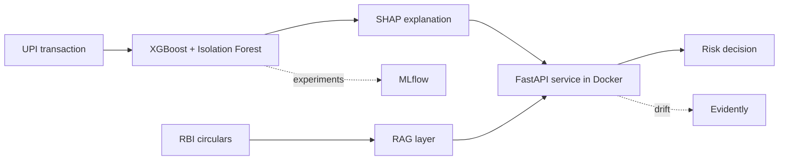

 

---

Final-year Computer Science and Engineering student at **SNS College of Technology, Coimbatore**, and Machine Learning Intern at **Epoch Minds**. I take an idea from problem discovery to a working API and a usable interface, usually under a hackathon clock.

---

## The Hackathon Trail

Most of what is below was built for a specific challenge. Each row is the brief, what I built, and where it stands.

| Challenge | What I built | Result |
|---|---|---|
| **Odoo × SNS Hackathon 2026** | Team solution for the Odoo challenge | **2nd Runner-Up** |
| **EVOX 1.0** (DETOX, on Unstop) | [City of One Rule](https://github.com/Sri-Gowtham/city-of-one-rule), a browser city simulation you steer with one rule a day, built with teammate Sanjana BR | **Winner, 1st place** among 2,000+ participants |
| **SNS Square Agent Workbench (UC-49)** | [CatalogIQ](https://github.com/Sri-Gowtham/catalogiq): agents that enrich, validate and publish FMCG listings | In development |
| **WebRush 2026** | [Rewind](https://github.com/Sri-Gowtham/rewind): listening data turned into story chapters | Completed |

---

## Featured Work

<table>
<tr>
<td width="50%" valign="top">

### [PayWatch](https://github.com/Sri-Gowtham/paywatch)
UPI transaction anomaly detection with XGBoost, Isolation Forest and SHAP explanations. Served with FastAPI and Docker, tracked in MLflow, drift-monitored with Evidently, with a RAG layer over RBI circulars.

</td>
<td width="50%" valign="top">

### [City of One Rule](https://github.com/Sri-Gowtham/city-of-one-rule)
**EVOX 1.0 winner.** You are the temporary mayor. Set one rule per day from a deck of 40 and watch 72 citizens react, copy each other and reshape the city. Everything is drawn procedurally on a canvas, with a deterministic simulation. [Play it](https://sri-gowtham.github.io/city-of-one-rule/).

</td>
</tr>
<tr>
<td width="50%" valign="top">

### [CatalogIQ](https://github.com/Sri-Gowtham/catalogiq)
**In development.** 11 agents that enrich, validate and publish FMCG product listings, with a feedback loop for optimisation. Built for the SNS Square Agent Workbench.

</td>
<td width="50%" valign="top">

### [Rewind](https://github.com/Sri-Gowtham/rewind)
A cinematic frontend that turns listening data into emotional story chapters. Built for the WebRush 2026 hackathon.

</td>
</tr>
<tr>
<td width="50%" valign="top">

### [FinSight Analytics Intelligence](https://github.com/Sri-Gowtham/finsight-analytics-intelligence)
AI financial intelligence for Indian banking: explainable insights, peer comparison and scenario analysis for consultancy firms.

</td>
<td width="50%" valign="top">

### [NayePankh AI Workforce](https://github.com/Sri-Gowtham/NayePankh-AI-Workforce)
A supervisor agent routes NGO work to volunteer, internship, content, analytics and resource agents, running locally on Ollama.

</td>
</tr>
</table>

<b>More projects</b>

 

- [VoltNexus](https://github.com/Sri-Gowtham/volt-nexus): analytics linking battery swaps, riders, stations, telemetry and pricing to service failures, retention and profitability
- [Roamio AI](https://github.com/Sri-Gowtham/roamio-ai): AI travel copilot that replans trips when disruptions occur
- [BudgetBee AI Finance](https://github.com/Sri-Gowtham/budget-bee-ai-finance): AI-assisted personal finance app
- [AI Scam Detector](https://github.com/Sri-Gowtham/ai-scam-detector) · [Mock Interviewer](https://github.com/Sri-Gowtham/mock-interviewer) · [Automated Content Repurposing Engine](https://github.com/Sri-Gowtham/Automated-Content-Repurposing-Engine)
- [Employee Attrition AI](https://github.com/Sri-Gowtham/Employee-Attrition-AI) · [Drug Sentiment Capstone](https://github.com/Sri-Gowtham/drug_sentiment_capstone): ML notebooks

All repositories: [github.com/Sri-Gowtham](https://github.com/Sri-Gowtham?tab=repositories)

---

## House Rules

City of One Rule is built on a simple idea: one rule can change a whole system. These are the rules that show up across my own projects.

| Rule | Where it shows up |
|---|---|
| **Explain every score** | SHAP explanations in PayWatch, explainable insights and peer comparisons in FinSight |
| **Make it deterministic and testable** | City of One Rule replays identically from the same seed and ships 30+ headless checks that run in CI |
| **Simulate the edge, keep the contract** | CatalogIQ simulates marketplace connections behind one interface, so a real workbench can replace the local one without touching the app |
| **Watch it after it ships** | PayWatch tracks experiments in MLflow and monitors drift with Evidently |

---

## How PayWatch Flows

---

## Toolbox

 

**AI and ML:** XGBoost, SHAP, NLP, LLM APIs, RAG, multi-agent systems, Ollama, Agno  
**MLOps and data:** MLflow, Evidently, Jupyter, Plotly, Streamlit

---

Open to collaborating with developers, engineers and founders building useful technology.

<a href="https://www.linkedin.com/in/sri-gowtham-m/">LinkedIn</a> · <a href="mailto:srigowtham289@gmail.com">srigowtham289@gmail.com</a>

